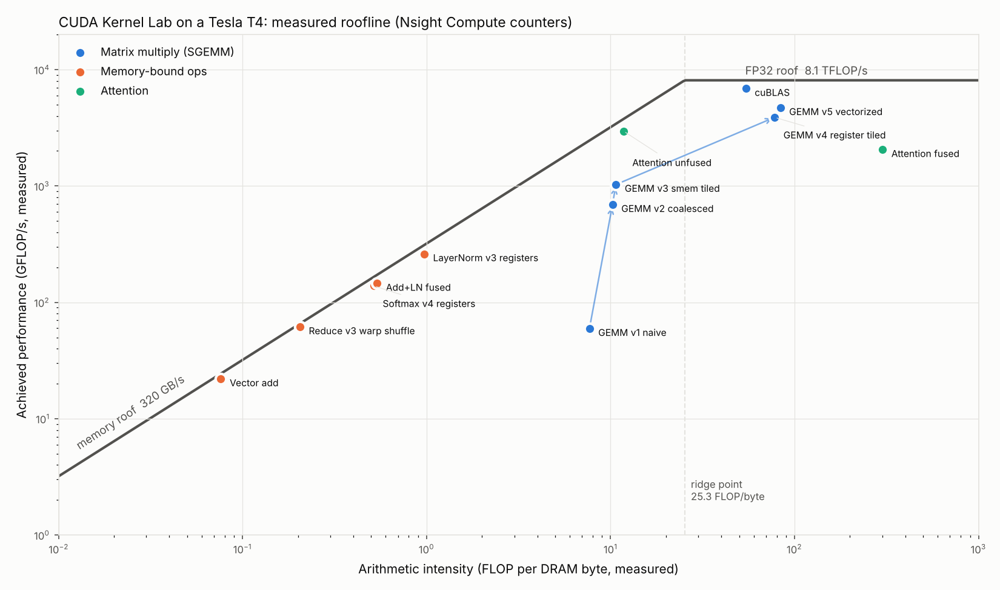

# I wrote 21 CUDA kernels on a free GPU. Here's what the profiler taught me.

*Draft for dev.to / personal site. Numbers are from [benchmarks/results.md](../benchmarks/results.md); every one was measured on a Colab Tesla T4.*

## Why

Every GPU software posting I read asked about coalescing, occupancy and shared memory. I could recite the definitions but had never seen any of it happen. So I set a rule: write each kernel naively first, measure it, then change one thing at a time and prove with Nsight Compute why it got faster. All of it ran on a free Colab T4 from a MacBook that has no NVIDIA GPU at all.

## The one idea that unlocked everything: the memory hierarchy

A GPU is mostly a machine for moving data. My first kernel, vector add, hit 263.8 GB/s, 82% of the T4's 320 GB/s spec, and could not go faster no matter what, because it does one addition per 12 bytes. Almost every speedup after that was the same move: get the data one level closer to the arithmetic, from DRAM to shared memory to registers.

- A sum over 16 million floats went from 1.9 GB/s to 247.8 GB/s (**133x**) by adding up in registers and combining with warp shuffles instead of 16.7 million atomics on one address.
- In matrix multiply, swapping two index lines so a warp reads consecutive addresses made it **8.2x** faster. Same math, same work.

## The counter that wasn't the whole story: 16,252,928 bank conflicts

My shared-memory transpose was barely faster than the naive one. Nsight Compute said why: 16,252,928 shared-memory bank conflicts. Reading a column of a `float[32][32]` tile puts all 32 threads of a warp in the same memory bank, and the count is exact: 4096² / 32 = 524,288 warp loads, each replayed 31 extra times. Padding the tile to `[32][33]` dropped the counter to **0** and the kernel got 1.8x faster.

Then I re-ran the full suite the next day on a newer CUDA toolchain. Same code, same 16,252,928 conflicts, but now padding was only worth 6%. The conflicts were still there; the newer build was simply hiding their latency behind other work. That changed how I read profilers: a counter tells you a problem exists, only a stopwatch tells you what it costs.

## The GEMM ladder

| Version | GFLOPS (4096³) | % of cuBLAS |
|---|---:|---:|
| naive | 61.7 | 1.7% |
| coalesced | 505.8 | 15.1% |
| shared-memory tiles | 776.0 | 23.2% |
| 8×8 register tiles | 2,841.4 | 85.1% |
| + `float4`, transposed A tile | **3,101.6** | **91.6%** |

The surprise was the third row. Tiling is supposed to cut global memory traffic 32x, and the kernel only got 1.5x faster. The DRAM counters explained it: reads barely moved (1,654 → 1,584 MB), because the L2 cache had already been catching the reuse. The real bottleneck had moved to shared memory, where the inner loop did one multiply-add per two loads. Register tiling fixed that by making each loaded value feed 8 multiply-adds.

Also humbling: cuBLAS measured anywhere from 3,165 to 3,575 GFLOPS across three runs. Same code, a hotter GPU hitting its 70 W cap. My kernel's ratio to cuBLAS stayed between 90% and 93%, which is why I only report same-run ratios and medians.

## Softmax and LayerNorm: when the textbook optimization doesn't help

Online softmax is the famous trick: compute the max and the sum in one pass instead of two. I implemented it, and it gave **zero** speedup. The counters showed why: my "3-pass" version only read 1.4x the minimum bytes, because each 16 KB row was still in cache when the next pass came back for it. What actually won was keeping the whole row in registers so it's read from DRAM exactly once: **1.25x faster than `torch.softmax`**. Same story for LayerNorm (**1.42x faster than `F.layer_norm`**).

Fusion did exactly what theory said. A residual add followed by LayerNorm costs 5 passes over memory as two kernels and 4 as one. The counters went from 375 MB to 304 MB, and the time from 1.370 to 1.127 ms: 1.22x, almost precisely 5 : 4. Against PyTorch eager, which launches them separately, the fused kernel is **1.44x** faster.

## Attention without the N×N matrix

The textbook attention writes every score to memory. At 8K tokens that's 4.3 GB; at 16K tokens it needs 17.2 GB and doesn't fit on the GPU at all. My fused kernel streams K and V through shared memory and folds each tile into the output with online softmax, so the score matrix never exists. This is where online softmax earns its reputation.

| Tokens | Textbook | Fused (mine) | PyTorch SDPA |
|---:|---:|---:|---:|
| 4,096 | 43.0 ms | **28.8 ms** | 25.6 ms |
| 8,192 | 196.6 ms | **112.2 ms** | 100.6 ms |
| 16,384 | out of memory | **453.6 ms** | 411.9 ms |

At 2K tokens the fused kernel moved 26x less data through DRAM (59 MB vs 1.5 GB). It is not faster everywhere: below about 2K tokens cuBLAS's matrix multiplies beat my one-thread-per-row loop, and PyTorch's production kernel is still about 10% ahead. That gap has a known cause (my design uses 254 registers per thread and leaves the GPU underoccupied) and a known fix (split rows across warps, use Tensor Cores), which is exactly what FlashAttention-2 does.

## The roofline

Every point is measured with hardware counters. The GEMM versions march up and to the right from the memory roof toward the compute roof; softmax and LayerNorm sit on the memory roof, which is exactly where a memory-bound kernel should end up. Once you can draw this chart you stop guessing which optimization to try next.

## What's next

Tensor Cores (WMMA), double buffering, and plugging these kernels into a small LLM inference server to measure their end-to-end effect.

*Code, raw numbers and profiler reports: [github.com/Musharaf-khan/cuda-kernel-lab](https://github.com/Musharaf-khan/cuda-kernel-lab)*
